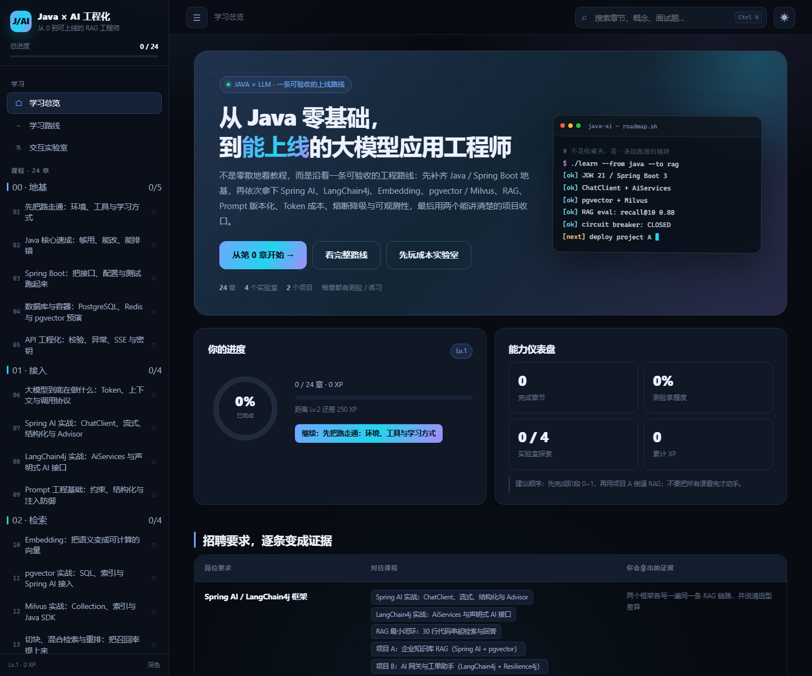

# Java × AI 工程化 · 从 0 到可上线的 RAG 工程师

一套可以直接在浏览器里学的交互式课程。目标不是“知道几个名词”，而是把招聘描述里的六项能力变成可运行、可演示、可追问的工程证据：

适合已有 Java 基础、初学 Spring 的读者。每章开头提供前置条件、操作顺序、预期结果和排错提示；Spring Boot 章节包含从 Controller 到 Service 的完整入门示例。

课程支持章节目录、收藏与本机阅读位置记录。跨设备自动同步和浏览器内 Java 运行尚未启用：云同步需要配置 Supabase 项目，安全运行需要可用且经过验证的 Docker 隔离环境。

- Spring AI / LangChain4j 框架接入
- RAG 应用落地
- Embedding 与向量检索（pgvector / Milvus）
- Prompt 版本化与灰度
- Token 成本控制
- 熔断、降级、限流与可观测性

## 30 秒开始

**Windows 推荐**：双击 **启动学习网站.bat**。脚本会启动本地服务并打开浏览器。

**手动启动**：

~~~bash
cd 学习
node server.js
# 浏览器打开 http://127.0.0.1:5178
~~~

没有 Node.js 也可以直接双击 **index.html**。所有课程内容都在本地，不依赖 CDN，也不需要 API Key。

## 课程包含什么

| 模块 | 内容 |
| --- | --- |
| 24 章阶梯课程 | Java 地基 → Spring Boot → 大模型 → 两大框架 → Embedding → pgvector / Milvus → RAG → 评测 → Prompt 治理 → 成本 → 韧性 → 项目 |
| 48 道随堂测验 | 选项即时判分、解释、重试；全部答对推进章节完成 |
| 24 个动手练习 | 关键点检查、逐条提示、参考答案；代码自动保存在本机 |
| 4 个交互实验室 | Token 成本、RAG 检索、熔断降级、Prompt 灰度 |
| 2 个实战项目 | 企业知识库 RAG、AI 网关与工单助手；含里程碑、API、验收与风险 |
| 30 道面试题 | 按 Java / 框架 / RAG / 向量 / 治理 / 稳定分组，可标记掌握 |
| 速查手册 | Java、Spring AI、LangChain4j、pgvector、Milvus、Resilience4j、Micrometer 片段 |
| 错题复习与备份 | 自动记录错题；导出或合并导入进度、练习草稿与实验室参数 |
| 环境诊断 | 通过本机服务检查 JDK、Maven、Git 和 Docker 状态；静态文件模式提供手动检查 |

## 七个阶段

1. **地基**：JDK 21、Spring Boot 3、REST、PostgreSQL、Docker、SSE、统一异常。
2. **接入**：Token 与上下文、ChatClient、AiServices、流式、结构化输出、工具调用。
3. **检索**：Embedding、余弦相似度、pgvector、Milvus、切块、混合检索、重排。
4. **RAG**：最小闭环、增量同步、权限、引用、多轮、50 条评测集与 CI 门禁。
5. **治理**：Prompt 不可变版本、灰度、回滚、审计；Token 预算、缓存、路由、对账。
6. **稳定**：分层超时、有限重试、熔断、降级链、限流、舱壁、多模型故障转移、指标与告警。
7. **收口**：两个项目、README、架构图、评测报告、压测数据、简历与 STAR 表达。

## 建议学习节奏

- 第 1 周：阶段 0，做出 hello-api。
- 第 2 周：阶段 1，两个框架各跑通一条流式对话。
- 第 3 周：阶段 2，pgvector 与 Milvus 双实现，写选型对比。
- 第 4 周：阶段 3，知识库上传、引用、50 条评测。
- 第 5 周：阶段 4 + 5，Prompt 灰度、成本看板、熔断降级、Grafana。
- 第 6 周：阶段 6，部署、压测、README 与模拟面试。

不要等“全部看完”再动手。每一章至少留下一个可运行文件、一段失败复盘或一张架构图。

## 目录结构

~~~text
学习/
  index.html              页面壳
  server.js               零依赖静态服务器
  启动学习网站.bat         Windows 一键启动
  assets/
    styles.css            深色 / 浅色主题与响应式
    app.js                路由、课程渲染、测验、练习、进度、搜索
    labs.js               四个交互实验室
    preview.png           README 预览图
  content/
    site.js               课程定位、能力矩阵、阶段
    stage0.js ~ stage6.js 24 章课程
    guides.js             逐章学习指引与 Spring 入门补充
    spring-practice.js    四章独立案例与操作说明
    rag-deep-dive.js      模型接入、检索与 RAG 逐步讲解
  examples/               四个完整项目与可下载 ZIP
    projects.js           项目数据
    interview.js          30 道面试题
    cheatsheet.js         速查片段
  tests/
    content.test.js       数据完整性
    browser.test.js       Edge CDP 冒烟测试（可选）
~~~

## 本地开发与验证

~~~bash
# 只检查课程数据：章数、测验答案、练习检查点、阶段引用
npm test

# 真实浏览器冒烟测试（需要先启动 server.js，且本机有 Edge）
npm run test:browser
~~~

浏览器测试会验证：首页、搜索、章节、测验判分、练习检查、Token 计算、RAG 检索、熔断状态、Prompt 发布/回滚、项目、面试、速查、移动端菜单，并收集未捕获异常。

## 内容口径

- 代码基线：JDK 21、Spring Boot 3.x、Spring AI 1.0.x、LangChain4j 1.x。
- 模型价格、模型名、starter 坐标会随生态变化，站点中的数字用于演示计算，接入时以官方文档与账单为准。
- 实验室的相似度、成本、灰度指标是教学模型，不是厂商真实数据；真实项目必须用自己的金标集、压测与账单校准。
- 练习的关键点检查只检查文本，不编译或执行代码；需要在自己的环境运行、验证结果。原有进度和草稿继续保存在原来的浏览器存储中。

## 说明

站点不收集任何数据。学习进度、练习代码和实验室参数只保存在当前浏览器的 localStorage 中。换浏览器或清理站点数据会丢失进度。

可在侧栏的“进度备份”导出 JSON 并在其他浏览器合并导入；冲突练习草稿优先保留当前设备版本。错题复习从更新后开始记录，已有记录只可恢复当前仍答错的题。

“环境诊断”需要从本机 `http://127.0.0.1:5178` 访问新版本地服务；已有服务若在更新前启动，请停止旧服务并重新启动。直接打开 HTML 或手机访问时，请使用页面上的手动命令。诊断不会安装软件或修改系统配置。

Spring AI、向量检索与 RAG 的新增案例均为本地模拟，并附真实服务接入说明；首次 Maven 构建仍需下载依赖。
